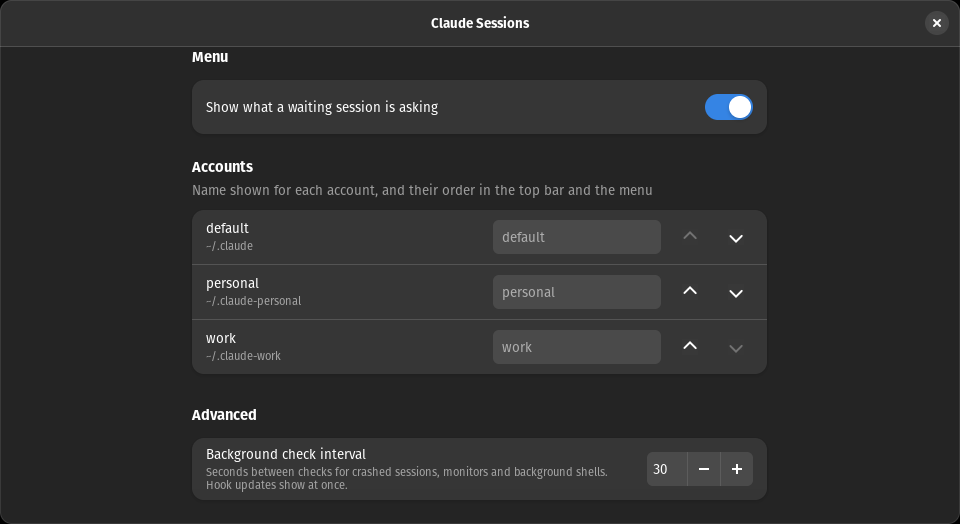

# Claude Sessions

A GNOME Shell extension that shows what every [Claude Code](https://claude.com/claude-code) session on
your computer is doing, right in the top bar — across several Claude accounts at once.


- **One light per account**, coloured by its most urgent session: you see at a glance when a session
  needs you, hit its usage limit, is still working, or is done.
- **Click a session** in the menu to raise its terminal. Background sessions (`claude --bg`) open in a
  terminal attached to them.
- **Mute** a session (eye icon) to keep it out of the top-bar light.
- **Rename and reorder accounts**, and choose which states are shown, in the settings window.
- **Instant updates**: Claude Code hooks write each session's state, and the extension watches them.

| Light | Meaning |
|-------|---------|
| 🔴 red, outlined | hit its usage limit (the turn stopped on a rate limit) |
| 🔴 red, pulsing | needs you (permission prompt or question) |
| 🟠 amber | working |
| 🟣 purple | turn ended, a Monitor script is still running |
| 🔵 blue | turn ended, a background Bash command is still running |
| 🟢 green | done |
| ⚪ grey | idle |
| ◯ hollow ring | every session of the account is muted |

## Requirements

- GNOME Shell 42 (tested on Pop!_OS 22.04, X11)
- Claude Code with hook support (`StopFailure` for the usage-limit light)
- `jq`

## Install

```sh
git clone https://github.com/Dhia-dbh/gnome-claude-sessions.git ~/src/gnome-claude-sessions
cd ~/src/gnome-claude-sessions
./install.sh
```

`install.sh` links the extension and the hook into place, compiles the settings schema, and adds the
hook to the `settings.json` of every Claude account it finds (`~/.claude` and `~/.claude-*`). Then
restart GNOME Shell (X11: <kbd>Alt</kbd>+<kbd>F2</kbd>, `r`; Wayland: log out and in) and run:

```sh
gnome-extensions enable claude-sessions@dhia.local
```

See [docs/installation.md](docs/installation.md) for manual setup and uninstalling.

## Multiple accounts

Each Claude account is a separate config directory, selected with `CLAUDE_CONFIG_DIR`. The extension
names each account after its directory: `~/.claude-work` → **work**, `~/.claude` → **default**.

```sh
alias claude-work='CLAUDE_CONFIG_DIR=~/.claude-work claude'
alias claude-personal='CLAUDE_CONFIG_DIR=~/.claude-personal claude'
```

Name the directories `~/.claude-<name>` and make sure the hook is in each one's `settings.json`.
[docs/accounts.md](docs/accounts.md) explains the detection in full.

## Settings




Open them from the menu (**Settings…**) or with `gnome-extensions prefs claude-sessions@dhia.local`.
Every option is described in [docs/settings.md](docs/settings.md).

## Documentation

- [Installation](docs/installation.md)
- [Accounts: how they are detected](docs/accounts.md)
- [Settings](docs/settings.md)
- [How it works](docs/how-it-works.md)

## License

[MIT](LICENSE) © 2026 Dhia Ben Hamouda. You may use, modify and sell this software, as long as the
copyright notice and license text are kept in copies of it.
