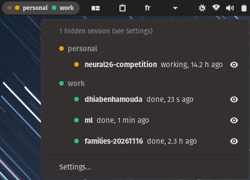
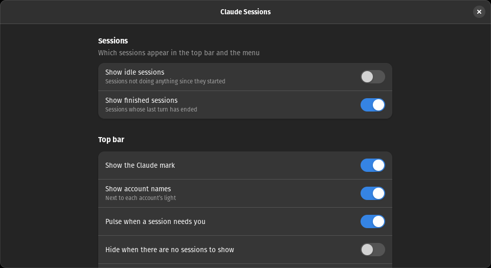

<div align="center">


[](https://github.com/Dhia-dbh/gnome-claude-codex-sessions/releases/latest)
[](LICENSE)
[](https://extensions.gnome.org/)
[](https://docs.claude.com/en/docs/claude-code/hooks)
[](https://github.com/Dhia-dbh/gnome-claude-codex-sessions/actions/workflows/release.yml)

</div>

# Claude & Codex Sessions

A GNOME Shell extension that shows what every [Claude Code](https://claude.com/claude-code) and
[Codex](https://developers.openai.com/codex) session on your computer is doing, right in the top bar —
across several accounts of each at once.

<p align="center">
  
</p>

- **One light per account**, coloured by its most urgent session: you see at a glance when a session
  needs you, hit its usage limit, is still working, or is done.
- **Claude Code and Codex side by side.** Each agent with open sessions gets its mark in the top bar
  (✳ Claude Code, `>_` Codex) followed by its accounts' lights. The menu is split by agent, then by
  account (work, personal, …). The colours mean the same thing for both.
- **Usage limits per account.** Bars that empty as the 5-hour and weekly limits are used, with the time
  until each resets, under every account in the menu, and (optional) stacked after its light in the top
  bar. Only accounts with open sessions show them.
- **Click a session** in the menu to raise its terminal. Background sessions (`claude --bg`) open in a
  terminal attached to them.
- **Mute** a session (eye icon) to keep it out of the top-bar light.
- **Rename and reorder accounts**, and choose which states are shown, in the settings window.
- **Instant updates**: Claude Code hooks write each session's state, and the extension watches them.

| Light | Meaning |
|-------|---------|
| 🔴 red, outlined | hit its usage limit (the turn stopped on a rate limit) |
| 🔴 red, pulsing | needs you (permission prompt or question) |
| 🟠 amber | working |
| 🟣 purple | turn ended, a Monitor script is still running |
| 🔵 blue | turn ended, a background Bash command is still running |
| 🟢 green | done |
| ⚪ grey | idle |
| ◯ hollow ring | every session of the account is muted |

## Requirements

| | |
|---|---|
| **Version** | 1.0.0 ([changelog](https://github.com/Dhia-dbh/gnome-claude-codex-sessions/releases)) |
| **GNOME Shell** | 42 (tested on Pop!_OS 22.04, X11) |
| **Claude Code** | with hooks (`StopFailure` for the usage-limit light) |
| **Codex CLI** | optional, with hooks (on by default; trust them once with `/hooks`) |
| **Tools** | `jq`, `glib-compile-schemas` |
| **License** | MIT |

The project was called *Claude Sessions* until it learned about Codex. Its extension id
(`claude-sessions@dhia.local`), settings schema and cache directory keep that name, so existing installs
and settings carry on unchanged.

## Install

Grab the zip from the [latest release](https://github.com/Dhia-dbh/gnome-claude-codex-sessions/releases/latest):

```sh
gnome-extensions install claude-sessions@dhia.local.shell-extension.zip
bash ~/.local/share/gnome-shell/extensions/claude-sessions@dhia.local/install.sh
```

or clone the repository:

```sh
git clone https://github.com/Dhia-dbh/gnome-claude-codex-sessions.git ~/src/gnome-claude-codex-sessions
cd ~/src/gnome-claude-codex-sessions
./install.sh
```

`install.sh` links the extension and the hook into place, compiles the settings schema, and adds the
hook to the `settings.json` of every Claude account (`~/.claude` and `~/.claude-*`) and to the
`hooks.json` of every Codex home (`~/.codex` and `~/.codex-*`) it finds. In Codex, run `/hooks` once and
trust the new hooks: Codex skips hooks you haven't reviewed. Then
restart GNOME Shell (X11: <kbd>Alt</kbd>+<kbd>F2</kbd>, `r`; Wayland: log out and in) and run:

```sh
gnome-extensions enable claude-sessions@dhia.local
```

See [docs/installation.md](docs/installation.md) for manual setup and uninstalling.

## Multiple accounts

Each Claude account is a separate config directory, selected with `CLAUDE_CONFIG_DIR`. The extension
names each account after its directory: `~/.claude-work` → **work**, `~/.claude` → **default**.

```sh
alias claude-work='CLAUDE_CONFIG_DIR=~/.claude-work claude'
alias claude-personal='CLAUDE_CONFIG_DIR=~/.claude-personal claude'
```

Name the directories `~/.claude-<name>` and make sure the hook is in each one's `settings.json`.
Codex works the same way with `CODEX_HOME`: `~/.codex` → **default**, `~/.codex-work` → **work**.
[docs/accounts.md](docs/accounts.md) explains the detection in full.

## Settings




Open them from the menu (**Settings…**) or with `gnome-extensions prefs claude-sessions@dhia.local`.
Every option is described in [docs/settings.md](docs/settings.md).

## Documentation

- [Installation](docs/installation.md)
- [Accounts: how they are detected](docs/accounts.md)
- [Settings](docs/settings.md)
- [How it works](docs/how-it-works.md)

## Contributing

Issues and pull requests are welcome. To release a new version, see
[Releasing](docs/installation.md#releasing-maintainers).

## License

[MIT](LICENSE) © 2026 [Dhia Ben Hamouda](https://github.com/Dhia-dbh). You may use, modify and sell this
software, as long as the copyright notice and license text are kept in copies of it.

<sub>Not affiliated with Anthropic. Claude and Claude Code are trademarks of Anthropic.</sub>
